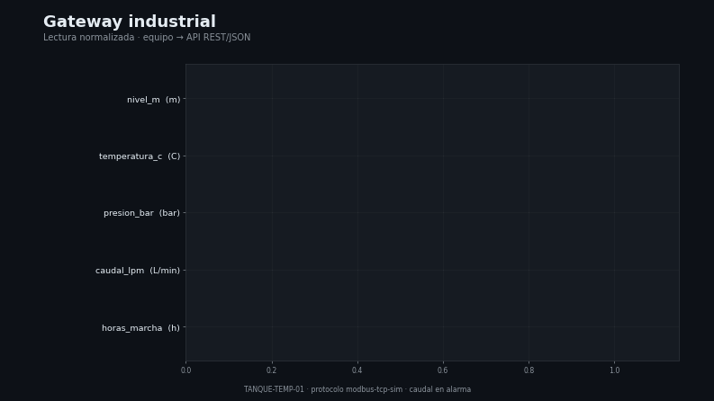

# Capa 2 — Integración de sistemas

[`lazarolpro/gateway-industrial`](https://github.com/lazarolpro/gateway-industrial) · parte del [portafolio de 9 capacidades](https://github.com/lazarolpro/portafolio)

**Capacidad demostrada:** conectar un equipo de campo con un sistema de
información, normalizando los datos y exponiéndolos como una API REST/JSON.

> © 2026 Ronny L. Díaz López. **Todos los derechos reservados.** El código fuente,
> los datos de detalle y los informes completos son propiedad del autor y no se
> publican. Prohibida su venta o uso comercial sin autorización escrita. Ver
> [`LICENSE`](LICENSE).

## Problema real

Los equipos industriales hablan protocolos de campo (Modbus, OPC-UA) y los
sistemas de gestión esperan JSON/HTTP. Sin una capa de integración, los datos
quedan aislados o se copian a mano.

## Qué hace

- Define un **mapa de registros** (dirección, tipo, escala, unidad, alarma).
- Simula la lectura del dispositivo (reemplazable por Modbus real).
- Normaliza y escala cada registro a unidades de ingeniería.
- Expone los datos como API REST/JSON y puede publicar una lectura por consola.

## Demo visual

La animación normaliza cada registro y marca la alarma de caudal. Video completo:
[`assets/gateway_demo.mp4`](assets/gateway_demo.mp4).

## Evidencia que produce

- `assets/gateway_demo.mp4`, `gateway_demo.gif`, `gateway_demo_poster.png` — demo
  visual animado (con miniatura).
- [`assets/muestra_integracion.pdf`](assets/muestra_integracion.pdf) — muestra
  resumida del contrato de integración y de una lectura normalizada (con marca de
  agua).
- [`config/device_map.json`](config/device_map.json) — contrato de integración
  versionado.
- [`sample_readings.json`](sample_readings.json) — lectura de ejemplo.

## Alcance de este repositorio

Este repositorio es una **vitrina del resultado**: muestra el contrato de
integración, una lectura normalizada y la muestra del informe. El **código fuente**
y los **informes completos** son propiedad del autor y se mantienen fuera del
repositorio público.

## Stack

Python 3 (solo biblioteca estándar: `http.server`). Sin dependencias externas.
*(El código no se publica; ver `LICENSE`.)*

## Por qué le importa a la empresa

Cubre la **integración con APIs de terceros y sistemas internos**: el mismo
patrón (leer → escalar → normalizar → exponer) sirve para cualquier equipo.

**En mantenimiento:** permite que un equipo de campo alimente el sistema de gestión
sin copiar datos a mano.
